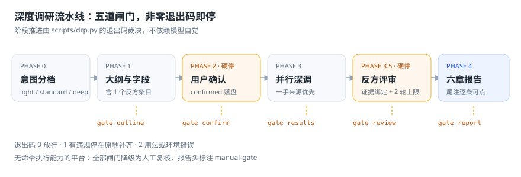
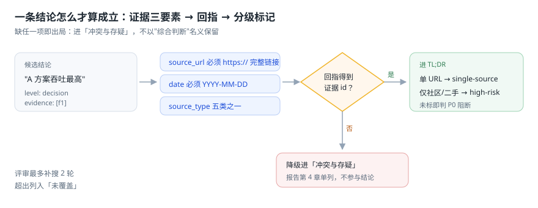
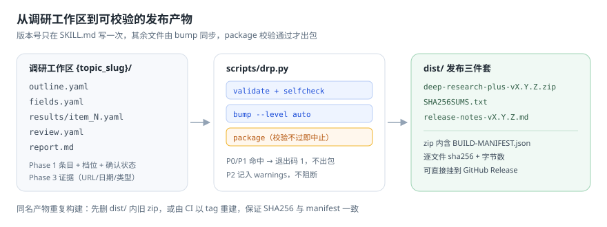

# Deep Research Plus

> 版本：1.5.0 ｜ 更新：2026-10-26

  

一个**带闸门的深度调研编排层**。它不重复造搜索能力，而是把「大纲 → 确认 → 深调 → 反方评审 → 报告」串成流水线，并用可执行脚本卡住每一步：没证据的结论进不了 TL;DR，只靠社区的结论会被打上 `high-risk`，单源支撑会被打上 `single-source`。

适用于 Claude Code / Codex / OpenCode / OpenClaw / WorkBuddy / Cursor / WPS AI 等任何能读 Markdown 的智能体。脚本层可选——没有命令执行能力时，全部闸门降级为人工复核并在报告头标 `manual-gate`。

## 它解决什么问题

普通 deep research 的失败模式很稳定，而且都是**流程问题**，不是模型能力问题：

| 失败模式 | 后果 | 本技能的拦截点 |
|----------|------|----------------|
| 大纲只收正面证据 | 结论天然偏向首选方案 | `kind: counter` 反方条目 + outline 闸门 |
| 引用写裸域名 | 无法回溯，等于没有引用 | https + 日期 + 来源类型三要素强校验 |
| 结论回指不到证据 | 观点冒充实证 | review 闸门：无 evidence 即 P0 |
| 单源/社区源当决策依据 | 谣言进正式文档 | `single-source` / `high-risk` 强制标记 |
| 评审越补越散 | 无限补搜，交期失控 | `rounds > 2` 直接判失败 |
| 先写报告再补证据 | 结论倒逼证据 | 五道闸门按顺序放行 |



## 三道硬闸门

| 闸门 | 卡什么 | 判定方式 |
|------|--------|----------|
| Phase 1 `outline` | 条目重叠、没有反方条目、字段未定义、档位与条目数不匹配 | `gate --stage outline` 退出码 |
| Phase 2 `confirm` | 用户没确认就开跑（`confirmed` / `confirmed_at` / `confirmed_by` 缺一不放行） | `gate --stage confirm` |
| Phase 3.5 `review` | 结论回指不到证据、单源未标、社区源冒充当决策依据、补搜超过 2 轮 | `gate --stage review` |



## 安装

### 完整安装（推荐，克隆即零降级）

```bash
git clone https://github.com/Asaceoo/deep-research-plus-skills.git
cd deep-research-plus-skills

# 编排层
mkdir -p ~/.workbuddy/skills/deep-research-plus
cp -r SKILL.md manifest.json scripts checklists docs ~/.workbuddy/skills/deep-research-plus/

# 四个子技能（版权归原作者，见 THIRD-PARTY-NOTICES.md）
cp -r sub-skills/deep-research      ~/.workbuddy/skills/
cp -r sub-skills/research           ~/.workbuddy/skills/
cp -r sub-skills/agent-reach        ~/.workbuddy/skills/
cp -r sub-skills/market-researcher  ~/.workbuddy/skills/

python ~/.workbuddy/skills/deep-research-plus/scripts/drp.py detect   # 期望 zero-degradation
```

其他平台把 `~/.workbuddy` 换成对应目录：Claude Code `~/.claude/skills/`、Codex `~/.codex/skills/`、OpenCode `~/.config/opencode/skills/`、OpenClaw `~/.openclaw/`；Cursor / WPS AI 直接读 `SKILL.md` 并按能力矩阵降级。

### zip 安装（仅编排层）

从 [Releases](https://github.com/Asaceoo/deep-research-plus-skills/releases) 下载 `deep-research-plus-vX.Y.Z.zip`，解压到 `skills/deep-research-plus/`。**zip 不含 sub-skills**，子技能缺失时 `detect` 会列出降级项，流水线仍可跑，能力缩水。

```bash
unzip deep-research-plus-v1.4.0.zip -d ~/.workbuddy/skills/deep-research-plus
python ~/.workbuddy/skills/deep-research-plus/scripts/drp.py validate
```

脚本零第三方依赖：有 PyYAML 用它，没有走内置子集解析。Python 3.8+。

## 快速开始

对话里直接说：

> 深度调研一下 2026 年主流开源 TTS 方案，帮我选型。

或者手工起一个工作区，把闸门当 CI 用：

```bash
D=~/.workbuddy/skills/deep-research-plus/scripts/drp.py

python $D init --workspace ./tts --topic "2026 主流开源 TTS 方案"   # 4 条目骨架，含反方条目
python $D gate --workspace ./tts --stage outline                    # 大纲闸门
python $D gate --workspace ./tts --stage confirm                    # 用户确认后落盘再过
python $D gate --workspace ./tts --stage results                    # 证据合规
python $D gate --workspace ./tts --stage review                     # 反方评审
python $D report --workspace ./tts                                  # 渲染六章报告
python $D gate --workspace ./tts --stage report                     # 报告合规
```

## 命令一览

| 命令 | 作用 |
|------|------|
| `validate` | 校验 frontmatter / 悬空路径 / 文档版本 / 清单规则 |
| `detect` | 探测四个依赖子技能，输出降级方案 |
| `init` | 生成 outline / fields / review 骨架 |
| `gate --stage <stage>` | 阶段闸门：outline / confirm / results / review / report |
| `report` | 渲染六章报告（自动生成尾注引用） |
| `bump` | 语义化版本递增，同步 SKILL.md / 文档 / README / CHANGELOG |
| `package` | 自动递增 + 全量校验 + zip + SHA256 + release notes |
| `selfcheck` | 清单逐条复核 + 内置流水线回归 |

退出码：`0` 通过 / `1` 有违规 / `2` 用法或环境错误。全部子命令支持 `--json`，便于接 CI 或其它 agent。
`gate --stage results --check-links` 额外联网 HEAD 探测证据链接（默认关闭，离线路径仍是零网络依赖）。

## 产物



`package` 产出三件套：`deep-research-plus-v<版本>.zip`、`SHA256SUMS.txt`、`release-notes-v<版本>.md`。zip 内附 `BUILD-MANIFEST.json`，逐文件记录 sha256，可校验来源与完整性。

## 文档

| 文档 | 内容 |
|------|------|
| [用户手册](./docs/user-guide.md) | 安装、五个真实场景、标记含义、故障排查 |
| [技术手册](./docs/technical-manual.md) | 架构、数据契约、闸门实现、错误码、规则引擎、扩展指南 |
| [对抗性审查记录](./docs/adversarial-review.md) | 三视角审查、多轮收敛、真机验证证据 |
| [第三方声明](./THIRD-PARTY-NOTICES.md) | 捆绑子技能的来源与版权归属 |
| [变更日志](./CHANGELOG.md) | 版本历史 |

## 文件结构

```
deep-research-plus/
├── SKILL.md                     # 技能入口（版本单一事实源）
├── manifest.json                # 包清单 + 文件登记
├── scripts/drp.py               # 工具层（单文件，零硬依赖）
├── checklists/skill_audit.yaml  # 八条机器规则
├── docs/                        # 双手册 + 审查记录 + 概念图
├── tests/                       # 112 条回归（含失败路径）
├── sub-skills/                  # 四个子技能（仅仓库，不随 zip）
└── dist/                        # 发布产物（不入库）
```

## 版本号规范

`SKILL.md` 的 `version` 是唯一事实源。`bump` 按 CHANGELOG `[Unreleased]` 判定递增级别（BREAKING → major，feat/新增 → minor，其余 → patch），并同步 `manifest.json`、`README.md`、`docs/*.md` 的版本与更新日期。`package` 先递增再校验，校验不过不出包。

## License

MIT（根目录许可不覆盖 `sub-skills/`，见 [THIRD-PARTY-NOTICES.md](./THIRD-PARTY-NOTICES.md)）
